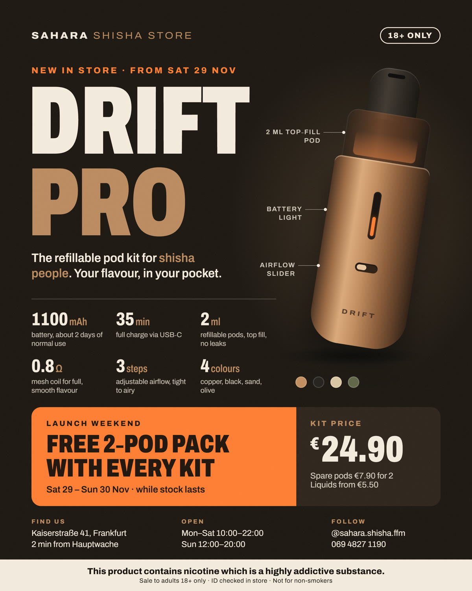
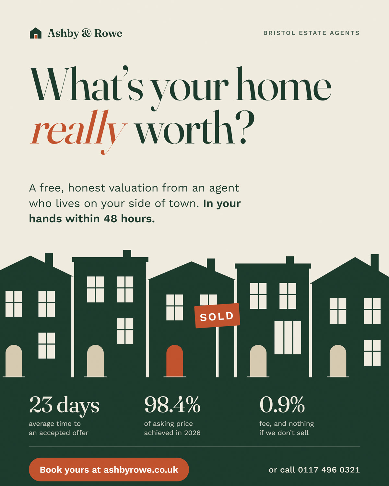
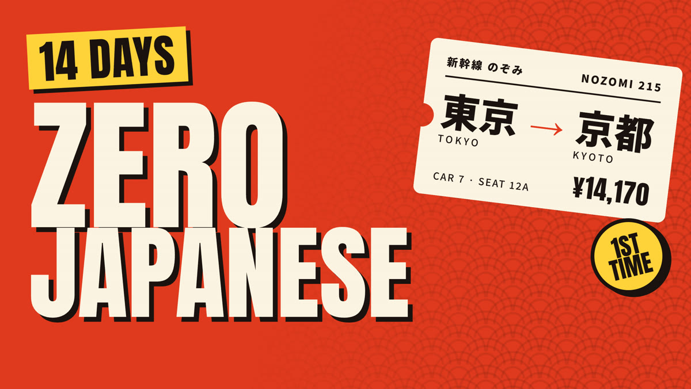
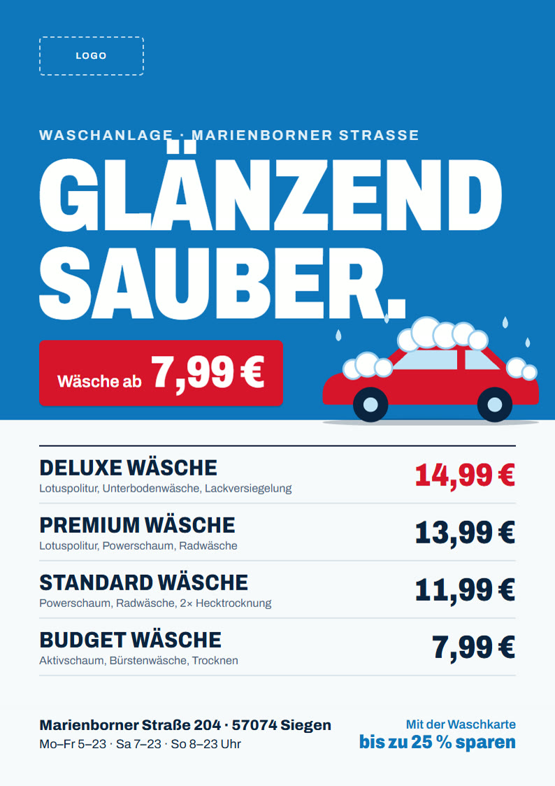
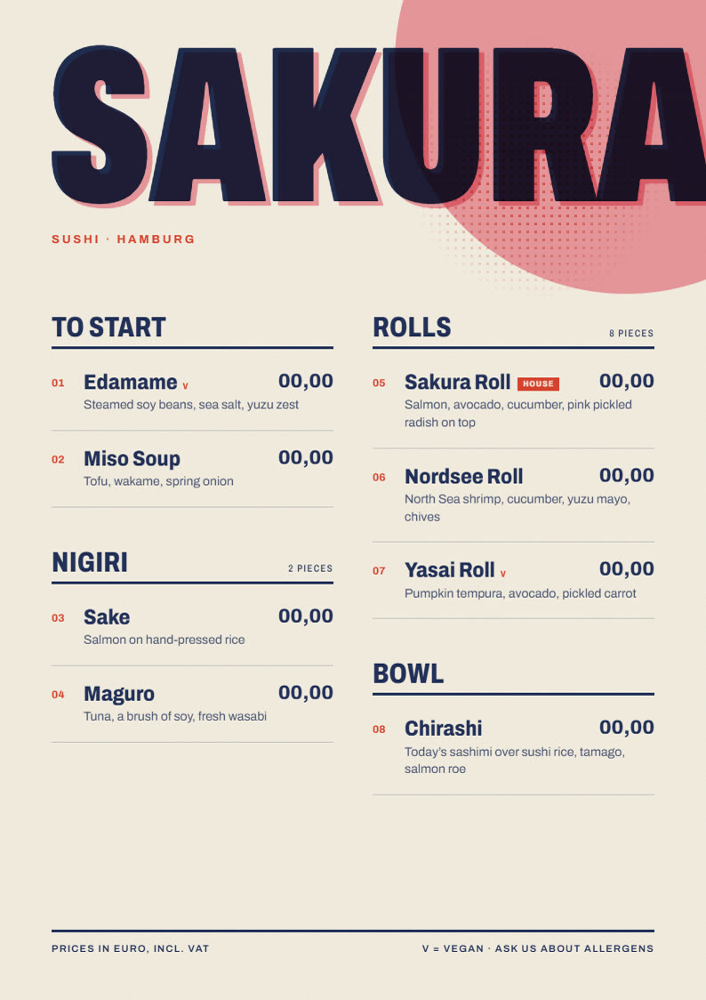

# designer: a Claude Code skill that makes images like a designer does

Most AI images look like AI images: garbled text, plastic shine, purple glow, everything centred. This skill takes a
different route. Claude doesn't paint pixels with an image model. It **acts as a designer**: it builds the image from
real fonts, a layout grid, colour, shapes and your own photos, renders it with the browser already on your computer,
and checks its own work before you see it.

<p align="center">
  
</p>
<p align="center">

</p>
<p align="center">
  
</p>

<sub>All made with this skill from one-sentence requests. Businesses, prices and contact details are examples; brand-styled ones are unofficial demos, not made for or with those brands. Club photo: Pexels (free licence).</sub>

## What it does
- **Asks 2-5 quick questions** you answer with a click (it writes the words for you if you want).
- **Learns your brand from your website or online store**: colours, fonts, logo, product photos, real prices.
- **First time for a business or channel: shows 3 different looks** (e.g. flat vs 3D, dark vs bright) and you pick one.
- **Remembers the picked style** (`designs/styles/<name>.md`), so every later image for that business matches.
- **Any format**: posters, menus, flyers, ads, YouTube thumbnails and banners, social posts, stories, business cards,
  logos, tickets, and anything else you describe.
- **Checks itself** against a designer's checklist and a list of "AI slop" tells, and fixes what fails.
- Text is always real text: sharp, editable, spelled right.

## Install
Requirements: [Claude Code](https://code.claude.com), **Node 18+**, and any **Chrome, Edge, Chromium or Brave**.
No npm packages.

```bash
# for all your projects
git clone https://github.com/yuneste/designer ~/.claude/skills/designer
# or only for one project
git clone https://github.com/yuneste/designer .claude/skills/designer
```
Then check your computer once:
```bash
node ~/.claude/skills/designer/scripts/check.mjs
```
No browser? The check prints a one-line fix that downloads a small headless Chrome just for this skill.

## Use
Just ask Claude Code, or type `/designer`:
- "make a menu for my sushi place"
- "a thumbnail for my video about learning Rust"
- "an Instagram ad for my bakery's weekend offer, here's my site: https://..."

Your files land in `designs/` in the folder you're working in.

## Tested
- Windows (Chrome and Edge), Linux (Ubuntu, with the downloaded headless Chrome) by hand.
- Every push runs `scripts/check.mjs` and renders the examples on Windows, macOS and Ubuntu with Node 18 and 22
  (see `.github/workflows/check.yml`).

## Good to know
- It never fakes photos or faces. Give it your own photo (your face, product, shop) and it designs around it.
- For a real business it never invents facts like prices or dates. For a made-up one it invents believable details and tells you which.
- Reading a website is for your own business. Some sites block automated visits; then it asks for screenshots.

MIT licence.
